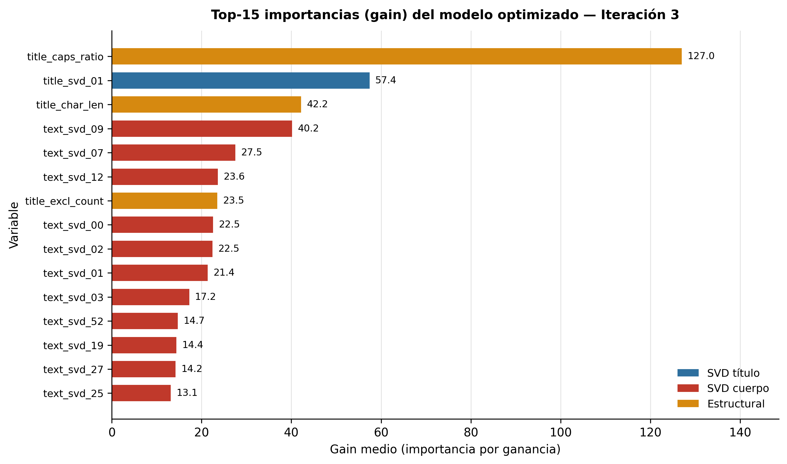
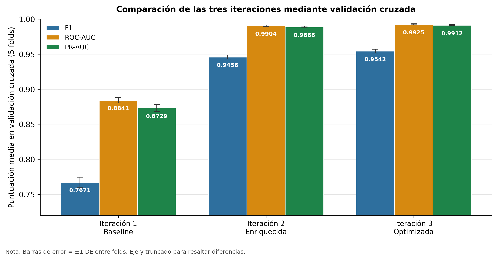

## 3.3 Marco Algorítmico, Modelado Iterativo y Optimización

La etapa anterior culminó con una matriz de 160 variables continuas —50 componentes del título, 100 del cuerpo y 10 descriptores lingüístico-estructurales y de sentimiento— construida sin fuga de información (véase la sección 3.2). Esta sección describe el marco algorítmico, el protocolo que compara tres configuraciones sucesivas y la estrategia de optimización de hiperparámetros; los resultados se reservan para las secciones 3.3.4 a 3.3.7.

### 3.3.1 Marco algorítmico: gradient boosting y XGBoost

El gradient boosting es un método de ensamble secuencial en el que varios árboles de decisión de baja complejidad se combinan para formar un predictor aditivo. A diferencia del bagging, que entrena modelos en paralelo y reduce la varianza, el boosting ajusta cada nuevo árbol sobre el error residual de la combinación anterior, de modo que la corrección es acumulativa y el sesgo disminuye de forma progresiva. Formalmente, la predicción para un artículo $i$ se expresa como $\hat{y}_i = \sum_{m=1}^{M} f_m(\mathbf{x}_i)$, con $f_m \in \mathcal{F}$, donde cada $f_m$ es un árbol de regresión de la familia $\mathcal{F}$ y $M$ es el número de iteraciones. Friedman (2001) interpretó este procedimiento como un descenso de gradiente en el espacio de funciones: en cada paso se elige la función que más reduce la pérdida a lo largo de la dirección negativa del gradiente, y la tasa de aprendizaje actúa como un factor de contracción que limita la contribución de cada árbol. Esa lectura permite sustituir la búsqueda directa por aproximaciones sucesivas tratables.

XGBoost (Chen y Guestrin, 2016) lleva esa idea a una función objetivo regularizada, en la que la pérdida empírica se complementa con un término que penaliza la complejidad del árbol:

$$\mathcal{L}^{(t)} = \sum_{i=1}^{n} l\left(y_i, \hat{y}_i^{(t-1)} + f_t(\mathbf{x}_i)\right) + \Omega(f_t), \qquad \Omega(f_t) = \gamma T + \frac{1}{2}\lambda \sum_{j=1}^{T} w_j^2 + \alpha \sum_{j=1}^{T} \lvert w_j \rvert,$$

siendo $T$ el número de hojas, $w_j$ el peso de la hoja $j$, $\gamma$ la penalización por cada hoja adicional, $\lambda$ el coeficiente de regularización L2 y $\alpha$ el de L1. La inclusión explícita de $\Omega(f_t)$ evita que el modelo crezca indefinidamente para memorizar el entrenamiento, algo especialmente relevante cuando el espacio de variables es amplio y las observaciones no son ilimitadas.

Para hacer tratable esa minimización, XGBoost aproxima la pérdida con una expansión de Taylor de segundo orden alrededor de la predicción previa. Si $g_i$ y $h_i$ denotan la primera y la segunda derivada de la pérdida respecto de $\hat{y}_i^{(t-1)}$, la contribución de cada observación queda resumida en esos dos estadísticos y el problema se reduce a encontrar la estructura que maximiza la ganancia

$$\mathcal{G} = \frac{1}{2}\left[\frac{G_L^2}{H_L+\lambda} + \frac{G_R^2}{H_R+\lambda} - \frac{(G_L+G_R)^2}{H_L+H_R+\lambda}\right] - \gamma,$$

donde $G_L$ y $G_R$ son las sumas de gradientes en las hojas izquierda y derecha, y $H_L$ y $H_R$ las de hessianos. Un split solo se acepta si la ganancia supera el costo $\gamma$ de crear una hoja; el peso óptimo de cada hoja queda dado por $w_j^{*} = -G_j/(H_j+\lambda)$. La implementación emplea `tree_method="hist"`, que discretiza las variables continuas en contenedores y acelera la búsqueda de cortes sin alterar de forma sustancial la calidad del ajuste.

Los hiperparámetros regulan ese equilibrio en cuatro frentes. La complejidad estructural depende de `max_depth`, que fija la profundidad máxima y, con ella, el orden de las interacciones representables, y de `min_child_weight`, que exige una suma mínima de hessianos por hoja y evita divisiones sustentadas en pocas observaciones. La estocasticidad se controla con `subsample`, la fracción de filas muestreada para cada árbol, y `colsample_bytree`, la fracción de columnas considerada; ambas decorrelacionan los árboles y actúan como regularización. El aprendizaje se gobierna con `learning_rate`, que contrae la aportación de cada árbol, y `n_estimators`, que determina cuántos se añaden: tasas pequeñas exigen más iteraciones y suelen generalizar mejor, mientras que tasas altas aceleran el ajuste a riesgo de sobreajustar. Por último, `reg_alpha` y `reg_lambda` penalizan la magnitud L1 y L2 de los pesos de las hojas, favoreciendo soluciones más dispersas o más suaves.

Este marco resulta adecuado porque la entrada es tabular, densa y de 160 dimensiones continuas, un escenario en el que los árboles explotan interacciones no lineales sin requerir cambios de escala ni supuestos distribucionales. Los componentes SVD resumen direcciones latentes del vocabulario y el modelo puede combinarlos mediante particiones sucesivas con la longitud, la proporción de mayúsculas o la polaridad; ninguna transformación monótona de esas variables altera los cortes disponibles. La regularización integrada y el muestreo controlan el sobreajuste en un corpus grande, mientras que `tree_method="hist"` mantiene un costo computacional razonable sobre 50.106 observaciones. Puesto que la clase positiva es Fake, la pérdida logística y las métricas centradas en esa clase alinean el entrenamiento con el objetivo sustantivo: identificar noticias falsas, no solo reproducir la etiqueta mayoritaria.

### 3.3.2 Diseño experimental iterativo

El protocolo parte de la partición estratificada fijada en la sección 3.2 sobre el corpus WELFake (Verma et al., 2021): 50.106 artículos para entrenamiento y 12.527 para test. Todas las decisiones de diseño, comparación y ajuste se toman exclusivamente sobre el entrenamiento mediante validación cruzada estratificada de cinco pliegues con `random_state=42`; el conjunto de test permanece reservado y no interviene en la selección de variables ni de hiperparámetros. Así, la evaluación de la etapa 4 se realiza sobre datos que el modelo nunca vio durante el desarrollo y no existe fuga de información entre ambas fases.

La primera iteración establece una línea base con las 50 componentes SVD del título y un `XGBClassifier(random_state=42)` sin ajuste específico. Su propósito es medir cuánta señal aporta por sí sola la estructura semántica del titular, que concentra buena parte de la intención editorial y es la porción más expuesta a los patrones de estilo. La segunda iteración conserva esas 50 componentes y añade las 100 del cuerpo y las 10 variables estructurales y de sentimiento, manteniendo los hiperparámetros por defecto; de este modo se aísla el efecto de incorporar el contenido completo y los rasgos de forma, sin confundirlo con un cambio en la configuración del algoritmo. La tercera utiliza las 160 variables y somete a XGBoost a una búsqueda aleatoria, de manera que su diferencia respecto de la segunda refleja el rendimiento atribuible a la optimización y no a una representación distinta.

La comparación escalonada descompone la mejora en dos fuentes: la información contenida en las variables y el ajuste del modelo. Si solo se presentara el modelo final, no sería posible saber si su desempeño proviene de la ingeniería de características de la etapa 2, del ajuste de hiperparámetros o de ambos. Las tres iteraciones se evalúan sobre las mismas particiones de validación cruzada, de modo que las diferencias observadas no se explican por variaciones en los pliegues.

La métrica principal es el F1 de la clase Fake (`label = 1`), media armónica de precision y recall sobre la clase positiva. La accuracy no basta porque agrega aciertos de ambas clases y puede permanecer alta aunque el modelo sea sistemáticamente conservador con las noticias falsas; en un problema de moderación informativa, los falsos positivos —señalar como falsa una noticia legítima— y los falsos negativos —dejar circular un contenido falso— tienen costos distintos y ninguno debe quedar oculto en un promedio global. El F1 obliga a equilibrar ambas dimensiones y se concentra en la clase de interés. Como métricas secundarias se registran accuracy, precision, recall, ROC-AUC y PR-AUC: la primera ofrece una referencia general, las dos siguientes separan los tipos de error, ROC-AUC resume la capacidad de ordenamiento en todos los umbrales y PR-AUC resulta más informativa cuando el foco está en el desempeño sobre la clase positiva.

### 3.3.3 Estrategia de optimización

La búsqueda de hiperparámetros se realiza mediante búsqueda aleatoria en lugar de grid search. El grid search recorre un producto cartesiano y su costo crece exponencialmente con el número de dimensiones; con ocho hiperparámetros y varios valores por cada uno, la rejilla completa sería inviable. Bergstra y Bengio (2012) mostraron que la búsqueda aleatoria explora mejor el espacio cuando solo unos pocos hiperparámetros son realmente influyentes, porque cada evaluación varía simultáneamente todas las dimensiones y no desperdicia ensayos en combinaciones redundantes. Por ello se programan 30 configuraciones, cada una evaluada en los cinco pliegues, lo que supone 150 ajustes para la tercera iteración.

El espacio de búsqueda cubre los ocho hiperparámetros con rangos amplios pero acotados por consideraciones de costo y estabilidad. `max_depth` se mueve entre 3 y 10, desde árboles poco profundos —sesgados hacia interacciones de bajo orden— hasta estructuras capaces de representar relaciones más complejas; `learning_rate` abarca de 0,01 a 0,20, combinando ajustes lentos que requieren más árboles con ajustes rápidos; `n_estimators` va de 200 a 800 para acompañar ambas escalas. La estocasticidad se explora con `subsample` entre 0,6 y 1,0 y `colsample_bytree` entre 0,4 y 1,0, permitiendo desde un muestreo agresivo hasta el uso completo de filas y columnas. `min_child_weight` se sitúa entre 1 y 10, `reg_alpha` entre 0 y 5 y `reg_lambda` entre 0,5 y 20, de modo que la búsqueda pueda preferir soluciones más o menos regularizadas según lo indique la validación.

Las 30 configuraciones se evalúan con `scoring="f1"` sobre la misma partición estratificada de cinco pliegues utilizada en las iteraciones anteriores, y la mejor se reentrena sobre la totalidad del entrenamiento. Mantener constante la partición es importante: si los pliegues cambiaran entre iteraciones, las diferencias de F1 podrían reflejar la dificultad de los pliegues y no el efecto de las variables o de los hiperparámetros. La selección se decide por el F1 medio de validación cruzada, sin consultar el conjunto de test, que sigue intacto para la evaluación final. La búsqueda no garantiza el óptimo global, pero cubre razonablemente un espacio demasiado grande para un barrido completo.

### 3.3.4 Iteración 1: línea base con el titular

Con las 50 componentes SVD del título y los hiperparámetros por defecto, la línea base obtuvo una exactitud de 0,7992 (DE = 0,0061), una precisión de 0,7971 (DE = 0,0080), un recall de 0,7393 (DE = 0,0084) y un F1 de 0,7671 (DE = 0,0071); el ROC-AUC llegó a 0,8841 (DE = 0,0037) y el PR-AUC a 0,8729 (DE = 0,0053).

Ese F1 sin acceso al cuerpo muestra que el titular concentra una parte sustancial de la señal: condensa la selección léxica y los recursos de estilo que la SVD resume en 50 direcciones latentes. La contrapartida es que no contiene la evidencia ni el desarrollo argumental, de modo que dos textos con titulares semejantes pueden pertenecer a clases distintas y esa ambigüedad fija un techo al modelo.

La precisión supera al recall en 0,0578: el modelo acierta cuando señala una noticia como falsa, pero deja sin detectar el 26,07 % de las falsas. Ese conservadurismo prefiere el falso negativo al falso positivo y se explica por la clase Fake (44,73 % del entrenamiento), por el ensamble pequeño de 100 árboles con `learning_rate = 0,3` y por la densidad de las componentes SVD. El ROC-AUC y el PR-AUC, superiores al F1, indican que parte de la pérdida proviene del umbral fijo de 0,5.

### 3.3.5 Iteración 2: cuerpo, estructura y sentimiento

Al añadir las 100 componentes del cuerpo y las 10 variables estructurales y de sentimiento, manteniendo estimador, hiperparámetros, partición y semilla, el F1 asciende a 0,9458 (DE = 0,0029); la exactitud llega a 0,9517 (DE = 0,0026), la precisión a 0,9486 (DE = 0,0043) y el recall a 0,9431 (DE = 0,0036), con un ROC-AUC de 0,9904 (DE = 0,0012) y un PR-AUC de 0,9888 (DE = 0,0013). El costo pasa a 13,5 s.

La mejora es de 0,1787 en F1, un 23,3 % relativo, de 0,2038 en recall y de 0,1515 en precisión. Como el único elemento que cambia es el conjunto de columnas, la diferencia proviene de las 110 variables adicionales y no del ajuste ni de la partición: es un contraste controlado del efecto de las variables. El recall reduce las noticias falsas no detectadas del 26,07 % al 5,69 % y la precisión también aumenta, sin intercambio entre ambas dimensiones, lo que indica que las variables añadidas separan las clases y no solo desplazan el punto de decisión.

El cuerpo aporta vocabulario, registro y estructura argumental; las variables estructurales y de sentimiento añaden forma y polaridad que el TF-IDF no representa, aunque son solo 10 de las 160 columnas. Puesto que la iteración conserva la configuración por defecto, su F1 es una cota inferior de lo que permite la representación de 160 variables.

### 3.3.6 Iteración 3: optimización de hiperparámetros

La tercera iteración conservó las 160 variables y aplicó una búsqueda aleatoria de 30 configuraciones en los cinco pliegues con `scoring="f1"`, para 150 ajustes. El mejor candidato alcanzó un F1 medio de 0,9542; la búsqueda consumió 1.169,78 s y el `cross_validate` final 69,95 s, lo que totaliza 1.239,73 s frente a 13,5 s de la iteración 2. La Tabla 6 resume el espacio explorado.

**Tabla 6**

*Espacio de búsqueda y configuración óptima de los hiperparámetros*

| Hiperparámetro | Rango explorado | Iteración 1–2 (por defecto) | Iteración 3 (óptima) |
|---|---|---|---|
| max_depth | 3–10 | 6 | 5 |
| learning_rate | 0,01–0,20 | 0,3 | 0,2 |
| n_estimators | 200–800 | 100 | 800 |
| subsample | 0,6–1,0 | 1,0 | 0,9 |
| colsample_bytree | 0,4–1,0 | 1,0 | 1,0 |
| min_child_weight | 1–10 | 1 | 7 |
| reg_alpha | 0–5 | 0,0 | 0,01 |
| reg_lambda | 0,5–20 | 1,0 | 2,0 |

*Nota.* Elaboración propia a partir de los resultados de la búsqueda aleatoria (*n* = 30 configuraciones × 5 pliegues).

El óptimo combina árboles poco profundos (`max_depth = 5`) con una tasa de aprendizaje de 0,2 y 800 árboles, un `min_child_weight = 7` que exige un mínimo de hessianos por hoja y un `subsample = 0,9`; `colsample_bytree` permanece en 1,0 y `reg_alpha = 0,01` es casi nulo, de modo que la regularización proviene de la profundidad y del peso mínimo de las hojas.

El valor `n_estimators = 800` coincide con el límite superior del espacio, y esa coincidencia es una limitación del diseño: no puede saberse si 1.000 o 1.200 árboles habrían mejorado el F1; 0,9542 es el mejor valor del espacio explorado y no un óptimo demostrado. Además, el valor por defecto previo es 100, inferior al mínimo explorado (200), por lo que la comparación 2–3 no aísla el ajuste del aumento de árboles.

La Figura 8 presenta las 15 variables con mayor gain.

**Figura 8**

*Importancia por ganancia de las quince variables principales*

*Nota.* Elaboración propia. Gain medio de la iteración 3; el color indica el grupo.

`title_caps_ratio` encabeza la lista con un gain de 126,999 (12,3848 % del total), más del doble que `title_svd_01` (57,42; 5,60 %). El dominio de la proporción de mayúsculas confirma que el estilo ortográfico es un indicio potente, aunque el gain mide la reducción de pérdida y no el sentido de la relación, que abordará la etapa 4. El peso del cuerpo matiza esa lectura: catorce de las veinte primeras variables son componentes suyas y suman el 25,66 % del gain, frente al 20,85 % de las cinco variables estructurales presentes en ese top-20 (23,48 % sumando las diez del modelo) y al 5,60 % de la única SVD del título. El cuerpo, en conjunto, supera a los demás bloques.

### 3.3.7 Comparación de las tres iteraciones y limitaciones

La Tabla 5 compara las tres iteraciones.

**Tabla 5**

*Rendimiento en validación cruzada de las tres iteraciones*

| Iteración | Variables | Exactitud | Precisión | Recall | F1 | ROC-AUC | PR-AUC | Tiempo (s) |
|---|---|---|---|---|---|---|---|---|
| Iteración 1 — Baseline | 50 SVD título | 0,799 (0,006) | 0,797 (0,008) | 0,739 (0,008) | 0,767 (0,007) | 0,884 (0,004) | 0,873 (0,005) | 6,8 |
| Iteración 2 — Enriquecida | 160: SVD + estructurales | 0,952 (0,003) | 0,949 (0,004) | 0,943 (0,004) | 0,946 (0,003) | 0,990 (0,001) | 0,989 (0,001) | 13,5 |
| Iteración 3 — Optimizada | 160 | 0,959 (0,002) | 0,956 (0,003) | 0,952 (0,004) | 0,954 (0,003) | 0,993 (0,001) | 0,991 (0,001) | 1.239,7 |

*Nota.* Elaboración propia. *M* (*DE*) entre pliegues; *n* = 50.106.

La primera transición aporta 0,1787 de F1 y la segunda 0,0084, algo más de veinte veces menos; el recall sigue el mismo patrón, con un salto de 0,2038 y luego de 0,0092. La mejora dominante proviene de las variables y no del ajuste, como resume la Figura 7.

**Figura 7**

*Comparación de las tres iteraciones mediante validación cruzada*

*Nota.* Elaboración propia. Barras de error = ±1 DE entre pliegues; eje y truncado.

La iteración 3 supera a la segunda en todas las métricas, pero con ganancias modestas: 0,0075 en exactitud, 0,0076 en precisión, 0,0092 en recall, 0,0021 en ROC-AUC y 0,0025 en PR-AUC. La diferencia de F1 (0,0084) supera la desviación estándar entre pliegues (0,0028 y 0,0029), pero sin prueba de significación no se afirma que sea estadísticamente significativa. El costo es inequívoco: 1.239,7 s frente a 13,5 s, casi dos órdenes de magnitud.

Las tres iteraciones usan el umbral fijo de 0,5 y en las tres la precisión supera al recall (0,7971 frente a 0,7393; 0,9486 frente a 0,9431; 0,9562 frente a 0,9523). Ese punto protege las noticias legítimas y acepta dejar pasar contenidos falsos; si el costo de ambos errores se invierte, un umbral más bajo aumentaría el recall a costa de precisión. Con ROC-AUC y PR-AUC de 0,9925 y 0,9912, el margen restante se concentra más en el umbral que en una nueva búsqueda.

El alcance está acotado por varias decisiones: el corpus es exclusivamente en inglés; se empleó una sola partición estratificada (80/20), cuya variabilidad no se explora; la búsqueda de 30 configuraciones careció de validación anidada, por lo que el mejor F1 es una estimación optimista; y `n_estimators` quedó en el límite superior, con el valor por defecto previo fuera del rango explorado. Las cifras provienen de validación cruzada sobre entrenamiento: la evaluación en test permanece pendiente y corresponde a la sección 3.4.

<!-- REFERENCIAS PARA EL DOCUMENTO FINAL
Bergstra, J., & Bengio, Y. (2012). Random search for hyper-parameter optimization. *Journal of Machine Learning Research, 13*, 281–305.
Chen, T., & Guestrin, C. (2016). XGBoost: A scalable tree boosting system. In *Proceedings of the 22nd ACM SIGKDD International Conference on Knowledge Discovery and Data Mining* (pp. 785–794). Association for Computing Machinery. https://doi.org/10.1145/2939672.2939785
Friedman, J. H. (2001). Greedy function approximation: A gradient boosting machine. *The Annals of Statistics, 29*(5), 1189–1232. https://doi.org/10.1214/aos/1013203451
Verma, P. K., Agrawal, P., Amorim, I., & Prodan, R. (2021). WELFake: Word embedding over linguistic features for fake news detection. *IEEE Transactions on Computational Social Systems, 8*(4), 881–893. https://doi.org/10.1109/TCSS.2021.3068519
-->
