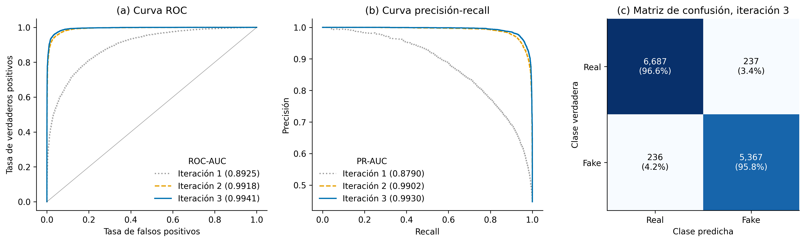
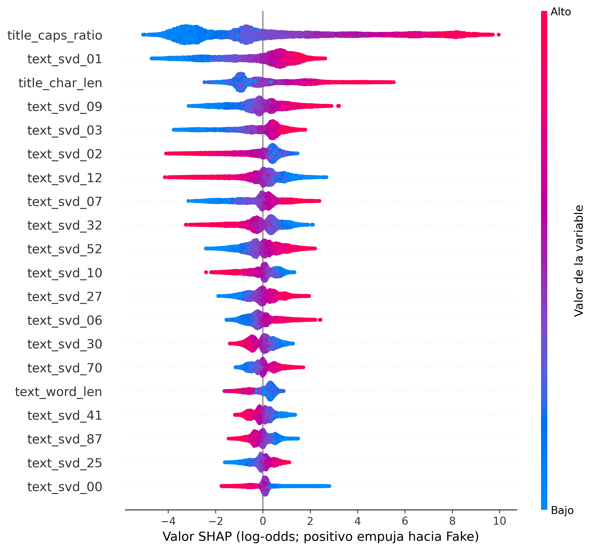
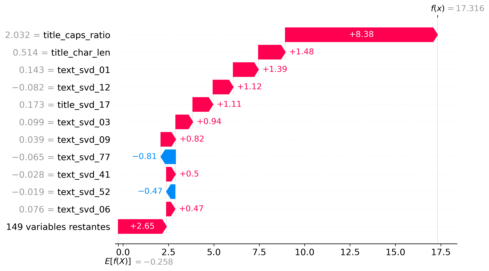
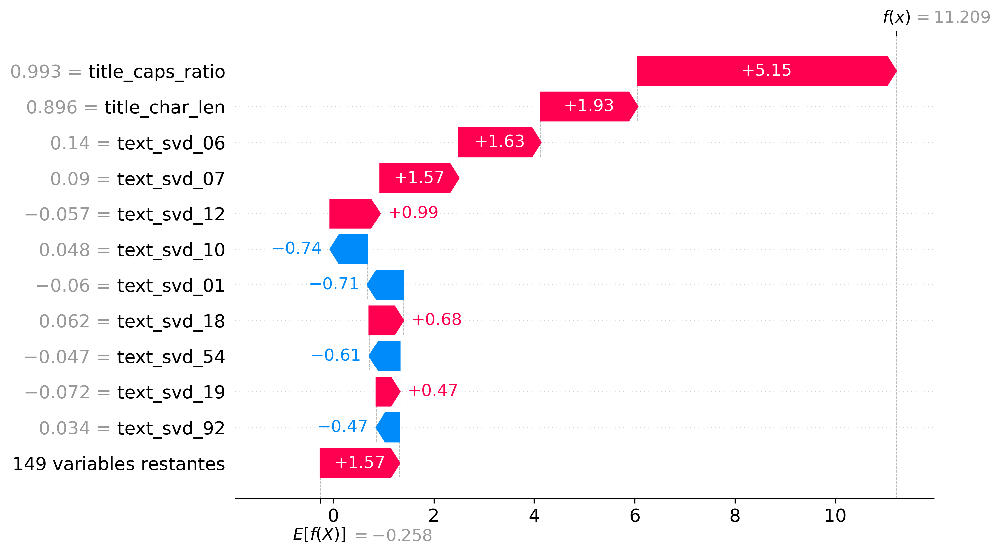

## 3.4 Evaluación comparativa, explicabilidad y análisis de errores

Las cifras de la sección 3.3 provienen de validación cruzada sobre el conjunto de entrenamiento y sirvieron para comparar y ajustar los modelos. Esta etapa responde tres preguntas distintas: cuánto rinden las tres iteraciones con artículos que no intervinieron en el ajuste, qué variables sostienen las decisiones del modelo optimizado y en qué casos falla.

### 3.4.1 Protocolo de evaluación

La evaluación se realizó sobre los 12,527 artículos del conjunto de prueba (6,924 reales y 5,603 falsos) separados en la sección 3.2. Los tres modelos se cargaron tal como se guardaron en la etapa anterior, sin reentrenarlos ni modificar sus hiperparámetros. El umbral de decisión se mantuvo en 0.5: un artículo se clasificó como falso cuando la probabilidad estimada de la clase positiva, *Fake*, alcanzó ese valor. Ajustar el umbral después de observar el conjunto de prueba habría convertido esos datos en parte del diseño y habría producido una estimación optimista (Kaufman et al., 2012).

Se calcularon las mismas seis métricas de la validación cruzada. La exactitud es la proporción total de aciertos. La precisión indica qué parte de los artículos señalados como falsos lo eran según el corpus, y el *recall*, qué parte de los falsos fue detectada. El F1, métrica principal del proyecto, es la media armónica de ambas. El ROC-AUC y el PR-AUC evalúan el ordenamiento de las probabilidades a lo largo de todos los umbrales; el segundo, calculado como precisión promedio, se concentra en la clase positiva (Saito y Rehmsmeier, 2015).

Los datos procesados no se distribuyen con el repositorio, por lo que se regeneraron con los scripts de las etapas 1 y 2. Antes de evaluar se comprobó, solo con el conjunto de entrenamiento, que las iteraciones 1 y 2 reprodujeran el F1 de validación cruzada documentado (0.7671 y 0.9458). Con la configuración óptima de la iteración 3 se obtuvo 0.9544, frente al 0.9542 registrado.

### 3.4.2 Comparación de los modelos en el conjunto de prueba

La Tabla 7 reúne las métricas y los conteos de las matrices de confusión.

**Tabla 7**

*Rendimiento de las tres iteraciones en el conjunto de prueba*

| Métrica | Iteración 1 | Iteración 2 | Iteración 3 |
|---|---|---|---|
| Exactitud | 0.8076 | 0.9544 | 0.9622 |
| Precisión | 0.8058 | 0.9499 | 0.9577 |
| Recall | 0.7508 | 0.9481 | 0.9579 |
| F1 | 0.7773 | 0.9490 | 0.9578 |
| ROC-AUC | 0.8925 | 0.9918 | 0.9941 |
| PR-AUC | 0.8790 | 0.9902 | 0.9930 |
| Verdaderos negativos | 5,910 | 6,644 | 6,687 |
| Falsos positivos | 1,014 | 280 | 237 |
| Falsos negativos | 1,396 | 291 | 236 |
| Verdaderos positivos | 4,207 | 5,312 | 5,367 |

*Nota.* Elaboración propia (*n* = 12,527; clase positiva: *Fake*; umbral de 0.5). La iteración 1 usa 50 componentes del titular; las iteraciones 2 y 3 usan las 160 variables.

La iteración 3 obtuvo el mejor resultado en las seis métricas. El cambio más grande ocurrió entre la primera y la segunda: el F1 aumentó 0.1717 y los errores totales bajaron de 2,410 a 571, una reducción del 76.3 %. La optimización de hiperparámetros añadió 0.0088 de F1 y redujo los errores de 571 a 473, es decir, 98 menos (17.2 %). Se confirma así en datos no usados para ajustar lo observado en la validación cruzada: la mayor parte de la mejora proviene de las variables y no del ajuste. No se aplicó una prueba de significación a las diferencias entre modelos.

El F1 en prueba fue de 0.7773, 0.9490 y 0.9578, ligeramente superior al de validación cruzada (0.7671, 0.9458 y 0.9542). La cercanía entre ambas estimaciones no muestra una caída de rendimiento al pasar a la partición de prueba. La pequeña ventaja puede deberse a que cada modelo final se entrenó con todos los datos de entrenamiento, mientras que en cada pliegue se usó el 80 %, y a la variación propia de una sola partición. Este resultado no permite concluir que el modelo rendirá igual con noticias de otras fuentes o de otro periodo.

La Figura 9 muestra las curvas de los tres modelos y la matriz de confusión del modelo optimizado.

**Figura 9**

*Curvas ROC y precisión-recall, y matriz de confusión del modelo optimizado*

*Nota.* Elaboración propia sobre el conjunto de prueba (*n* = 12,527). Los porcentajes de la matriz se calculan sobre el total de cada clase verdadera.

Las curvas de las iteraciones 2 y 3 son casi coincidentes y quedan claramente por encima de la correspondiente a la línea base. En la matriz de la iteración 3, los errores se reparten de forma casi simétrica: 237 artículos reales se clasificaron como falsos (3.4 % de los reales) y 236 falsos se clasificaron como reales (4.2 % de los falsos). La línea base, en cambio, producía más falsos negativos (1,396) que falsos positivos (1,014).

### 3.4.3 Explicabilidad global con SHAP

La importancia por ganancia de la sección 3.3 indica cuánto reduce la pérdida cada variable, pero no en qué dirección influye ni cómo actúa en un artículo concreto. Para ello se emplearon los valores SHAP, que reparten la salida de un modelo entre sus variables a partir de los valores de Shapley (Lundberg y Lee, 2017). Se usó TreeExplainer, el algoritmo diseñado para modelos basados en árboles (Lundberg et al., 2020), sobre la iteración 3 y los 12,527 artículos de prueba.

Los valores están en la escala de *log-odds*. Un valor positivo empuja la predicción hacia *Fake* y uno negativo, hacia *Real*. Para cada artículo, la suma del valor base (−0.258) y las 160 contribuciones reconstruye la salida del modelo; la diferencia máxima observada fue inferior a 0.0001. Estas contribuciones describen el comportamiento del modelo y no relaciones causales sobre la veracidad de una noticia.

**Figura 10**

*Resumen SHAP de las veinte variables más influyentes de la iteración 3*

*Nota.* Elaboración propia. Cada punto es un artículo de prueba. Las variables se ordenan por la media del valor SHAP absoluto; el color representa el valor de la variable.

Como muestra la Figura 10, la proporción de mayúsculas del titular (`title_caps_ratio`) es la variable más influyente, con una media absoluta de 2.926, más del doble que la segunda, `text_svd_01` (1.203). En general, las proporciones altas empujan hacia *Fake* y las bajas hacia *Real*. La tercera es la longitud del titular en caracteres (1.099): los titulares largos tienden a empujar hacia *Fake*. Ambos patrones concuerdan con las diferencias descritas en las secciones 3.1 y 3.2.

Si se suman las medias absolutas por bloque, los 100 componentes del cuerpo concentran el 71.7 % del total; las 10 variables estructurales y de sentimiento, el 17.2 %, y los 50 componentes del titular, el 11.1 %. Así, aunque una sola variable de estilo ocupa el primer lugar, el contenido del cuerpo aporta en conjunto la mayor parte de la atribución. Los bloques tienen distinto número de variables, por lo que estas proporciones no comparan la influencia promedio de cada una.

Los componentes SVD no tienen un significado directo. Una aproximación consiste en revisar los términos con mayor carga positiva y negativa en cada uno. En `text_svd_01`, el extremo positivo reúne términos de la campaña estadounidense (“clinton”, “trump”, “hillary”, “campaign”), y el negativo, vocabulario de información internacional y atribución de declaraciones (“minister”, “said”, “military”, “government”). Los valores altos empujan hacia *Fake* y los bajos hacia *Real*. De forma similar, en `text_svd_12` los valores altos, asociados con tratamientos como “mr” y “ms”, favorecen la clase *Real*. Estas lecturas sugieren que el modelo aprovecha temas y convenciones de redacción. Cada componente es una combinación de muchos términos, así que la interpretación es solo orientativa.

La lista de términos también reveló una limitación: “reuters” aparece entre las cargas positivas de `text_svd_87`. Las reglas de la sección 3.2 retiraron cabeceras, firmas y sufijos concretos, pero no todas las menciones de la agencia. No se midió cuánto influye esa palabra en las predicciones, de modo que no puede descartarse un residuo de información sobre la fuente.

### 3.4.4 Explicaciones locales

Se analizaron dos predicciones individuales elegidas con reglas fijas. El acierto es el verdadero positivo con la probabilidad más alta, y el error es el caso, entre los analizados en el apartado siguiente, cuya probabilidad quedó más lejos del umbral. Son ejemplos extremos y no casos típicos.

La Figura 11 corresponde a un artículo falso cuyo titular, “HOW PEOPLE MAGAZINE COVER Proves Hillary Has ALWAYS Been Wildly Unpopular With Women”, escribe varias palabras completas en mayúsculas.

**Figura 11**

*Explicación SHAP de un artículo falso clasificado correctamente*

*Nota.* Elaboración propia (artículo 770). Las variables estructurales se muestran estandarizadas y los componentes SVD, sin transformación adicional.

La salida pasa del valor base de −0.258 a 17.316 en *log-odds*, equivalente a una probabilidad que se redondea a 1.0000. La proporción de mayúsculas del titular, igual a 0.500 antes de estandarizar, aporta +8.38. Le siguen la longitud del titular (+1.48) y `text_svd_01` (+1.39). Algunas variables empujan en sentido contrario, como `text_svd_77` (−0.81), pero no compensan al resto.

La Figura 12 presenta un falso positivo: una columna etiquetada como real, firmada “DELINGPOLE” en el titular y escrita con un tono abiertamente opinativo.

**Figura 12**

*Explicación SHAP de un artículo real clasificado como falso*

*Nota.* Elaboración propia (artículo 11183). Las variables estructurales se muestran estandarizadas y los componentes SVD, sin transformación adicional.

La salida llega a 11.209. La proporción de mayúsculas (0.338 antes de estandarizar) aporta +5.15, y la longitud del titular, +1.93. Dos componentes del cuerpo, `text_svd_06` y `text_svd_07`, suman otros +3.20. Las contribuciones hacia *Real*, como `text_svd_10` (−0.74) y `text_svd_01` (−0.71), son mucho menores. El caso muestra que una probabilidad muy alta no garantiza que la predicción sea correcta.

### 3.4.5 Análisis de errores

De los 473 errores de la iteración 3, 164 (34.7 %) se cometieron con una probabilidad superior a 0.9 para la clase equivocada, y 153 (32.3 %), con una probabilidad inferior a 0.7. En el primer grupo, mover el umbral de forma moderada no corregiría el error.

Para el análisis textual se seleccionaron los tres falsos positivos y los tres falsos negativos en los que el modelo se alejó más de la etiqueta. La selección fue automática y se revisaron el titular y hasta los primeros 2,500 caracteres de cada cuerpo. La Tabla 8 resume los seis casos.

**Tabla 8**

*Seis errores extremos de la iteración 3*

| Id y tipo | P(Fake) | Titular | Principales contribuciones SHAP | Rasgos observados |
|---|---|---|---|---|
| 11183, FP | > 0.9999 | DELINGPOLE: Tom Steyer Is In So Deep With The Russians They Should Call Him ’Impaled by Vlad’ | Mayúsculas (+5.15); longitud del titular (+1.93) | Columna con calificativos y tono acusatorio |
| 27814, FP | > 0.9999 | DELINGPOLE: The Archbishop of Canterbury Thinks We’re All Fascists. Cheers! - Breitbart | Mayúsculas (+3.45); signos de exclamación (+1.08) | Opinión en primera persona, ironía y lenguaje soez |
| 22547, FP | 0.9999 | PINKERTON: Your Money or Your Life -- Fighting Over Obamacare vs. Fighting for Medical Cures | Mayúsculas (+3.18); longitud del titular (+2.00) | Ensayo argumentativo, parte de una serie |
| 15552, FN | 0.0001 | Terrorists attack police training college in Pakistan: 60 cadets killed and 120 injured | Mayúsculas (−4.34); `text_svd_01` (−3.34) | Nota informativa con cifras y fuentes atribuidas; restos de publicidad |
| 1929, FN | 0.0003 | If anyone doubts Bernie Sanders would've crushed Trump, show them this | Mayúsculas (−3.40); `text_svd_01` (+1.77) | Análisis electoral con cifras por estado |
| 39248, FN | 0.0004 | Philippine President Duterte wants US troops out in two years | `text_svd_01` (−3.46); mayúsculas (−2.01) | Nota breve con citas textuales y crédito fotográfico de AFP |

*Nota.* Elaboración propia. FP = falso positivo (real clasificado como falso); FN = falso negativo (falso clasificado como real). Los titulares se reproducen del corpus original; las reglas de la sección 3.2 se aplicaron antes de calcular las variables.

Los tres falsos positivos son textos de opinión o argumentación, y en los tres la proporción de mayúsculas fue la mayor contribución hacia *Fake*. Sus titulares comienzan con el apellido de una firma escrito en mayúsculas, lo que eleva esa proporción. Una posible explicación es que el modelo confunde un estilo editorial llamativo con el estilo predominante en la clase falsa. En el artículo 1,929 ocurre algo distinto: aunque `text_svd_01` empuja hacia *Fake*, el titular casi sin mayúsculas y otros componentes del cuerpo inclinan la salida hacia *Real*.

Los artículos 15552 y 39248 usan una redacción propia de las notas informativas, con titulares sobrios y declaraciones atribuidas. Esa forma se parece a la que predomina en la clase real. El análisis no verificó de manera externa los hechos ni revisó el criterio de etiquetado, así que no permite afirmar que estas etiquetas sean correctas o erróneas. WELFake combina artículos de varios conjuntos previos (Verma et al., 2021), por lo que la etiqueta podría reflejar en parte su procedencia, y un texto copiado o redistribuido podría conservar el estilo de una agencia aunque pertenezca a la clase falsa. Esta es una hipótesis que habría que comprobar rastreando el origen de cada texto.

En conjunto, los casos son compatibles con un clasificador que reconoce patrones de estilo y vocabulario asociados con cada clase, pero que no verifica hechos. Al tratarse de seis errores extremos, no son una muestra representativa de los 473 y no permiten estimar la frecuencia de cada patrón. En un uso real, la salida debería servir para priorizar artículos para revisión humana, no para decidir por sí sola que una noticia es falsa.

### 3.4.6 Limitaciones de la evaluación

La primera limitación es que entrenamiento y prueba proceden del mismo corpus. Una partición aleatoria reparte entre ambos conjuntos las mismas fuentes, temas y periodos, por lo que las métricas describen el desempeño dentro de WELFake. Medir la generalización requeriría un conjunto externo o una partición por fuente o por fecha.

La segunda es la posible repetición de contenido. En 153 artículos de prueba, el vector SVD del cuerpo, redondeado a seis decimales, coincide con el de algún artículo de entrenamiento; en 33 de ellos todos sus valores son cero. La coincidencia de vectores no demuestra que los textos sean idénticos. Una explicación posible para parte de los casos es que la deduplicación se hizo antes de retirar las marcas de procedencia. El modelo acertó los 153 artículos; al excluirlos, el F1 pasa de 0.9578 a 0.9573, por lo que su efecto en el resultado general es pequeño. Esta comprobación no detecta textos casi iguales.

La tercera es la dependencia de rasgos de forma. La proporción de mayúsculas cambia con las normas de estilo de cada medio y es fácil de modificar. Junto con las menciones de agencia que permanecen en el vocabulario, esto aconseja repetir la evaluación sin esas señales y con fuentes no vistas. Por último, el análisis se limita a artículos en inglés, usa un solo umbral y no evalúa la calibración de las probabilidades.

Dentro de estos límites, el modelo optimizado alcanzó un F1 de 0.9578 y un ROC-AUC de 0.9941 en el conjunto de prueba. SHAP muestra que sus decisiones combinan el vocabulario del cuerpo con rasgos del titular, y el análisis de errores señala situaciones en las que esas señales no bastan para distinguir una noticia falsa de una real.

<!-- REFERENCIAS PARA EL DOCUMENTO FINAL (añadir a las ya existentes)
Hutto, C., & Gilbert, E. (2014). VADER: A parsimonious rule-based model for sentiment analysis of social media text. Proceedings of the International AAAI Conference on Web and Social Media, 8(1), 216-225. https://doi.org/10.1609/icwsm.v8i1.14550
Lundberg, S. M., & Lee, S.-I. (2017). A unified approach to interpreting model predictions. Advances in Neural Information Processing Systems, 30, 4765-4774.
Lundberg, S. M., Erion, G., Chen, H., DeGrave, A., Prutkin, J. M., Nair, B., Katz, R., Himmelfarb, J., Bansal, N., & Lee, S.-I. (2020). From local explanations to global understanding with explainable AI for trees. Nature Machine Intelligence, 2(1), 56-67. https://doi.org/10.1038/s42256-019-0138-9
Saito, T., & Rehmsmeier, M. (2015). The precision-recall plot is more informative than the ROC plot when evaluating binary classifiers on imbalanced datasets. PLOS ONE, 10(3), e0118432. https://doi.org/10.1371/journal.pone.0118432
Kaufman et al. (2012) y Verma et al. (2021) ya están en la lista del documento.
-->
